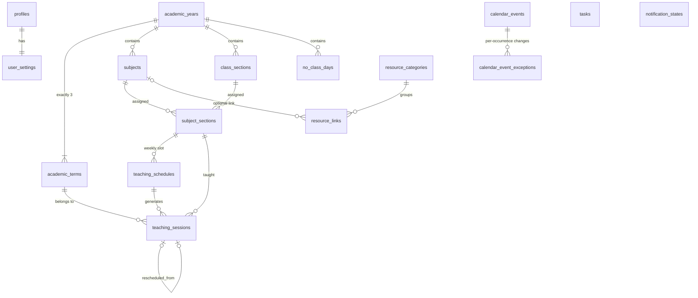

# Architecture

Manunudlo is an individual-teacher web app on the DepEd **three-term** calendar.
Next.js 16 (App Router, TypeScript, Tailwind) on Vercel; Supabase for Postgres, Auth and row-level security.

## Layers

```
Browser ── Next.js pages (Server Components) ── services/*  ── Supabase (RLS)
   │              │                                  ▲
   │              └── Server Actions (features/*/actions.ts) ──┘
   └── client components (forms, boards, calendar) call Server Actions only
```

| Layer               | Where                                         | Responsibility                                                                           |
| ------------------- | --------------------------------------------- | ---------------------------------------------------------------------------------------- |
| Routing + auth gate | `src/proxy.ts`, `src/lib/supabase/session.ts` | Refresh the session cookie; redirect signed-out visitors to `/login`.                    |
| Pages               | `src/app/(app)/*`, `src/app/(auth)/*`         | Server-render each module from real records.                                             |
| Services (reads)    | `src/services/*`                              | Query Supabase, scope by teacher, map rows to types.                                     |
| Features            | `src/features/<module>/`                      | `rules.ts` (pure validation, unit-tested), `actions.ts` (Server Actions), UI components. |
| Database            | `supabase/migrations/*`                       | Tables, constraints, triggers, RPC functions, RLS. **Final authority** on every rule.    |

Validation is written twice on purpose: in TypeScript for friendly messages, and in the database so no client can bypass it.

## Modules (six primary destinations)

Home · Calendar & Planner · Tasks & Responsibilities · My Classes · Resources · Reports & Accomplishments.
Settings, Help and the notification bell live in the top bar / account menu.

## Data model



Every table except `profiles` carries `user_id`; composite foreign keys `(id, user_id)` make it impossible to
link rows that belong to different teachers.

## Core rules and where they live

| Rule                                                                 | Enforced by                                                                                                                                                                                            |
| -------------------------------------------------------------------- | ------------------------------------------------------------------------------------------------------------------------------------------------------------------------------------------------------ |
| Exactly three terms per academic year, never quarters                | `check_academic_year_terms` trigger + `save_academic_year()` RPC; term dates must be inside the year and must not overlap                                                                              |
| A session belongs to the term containing its date                    | `enforce_session_rules` trigger (rejects dates outside every term)                                                                                                                                     |
| **Only `completed` sessions count** toward totals, hours and reports | `completed_session_report()` SQL function (`where status = 'completed'`); dashboard uses the same rule                                                                                                 |
| Rescheduling keeps history                                           | `reschedule_session()` marks the original `rescheduled`, creates a new `scheduled` session linked by `rescheduled_from_id`; the original never counts                                                  |
| Schedule changes never rewrite history                               | `save_teaching_schedule()` and deleting a schedule touch only _Scheduled_ sessions; completed, cancelled and rescheduled ones are kept. Subjects or sections with completed sessions cannot be deleted |
| Tasks never affect reports                                           | Reports read `teaching_sessions` only                                                                                                                                                                  |
| Dates are school-local                                               | "Today" is evaluated in Asia/Manila (`todayISO()`, `nowInSchool()`, `school_today()`)                                                                                                                  |

## Notifications

Derived live from records (upcoming sessions, events, deadlines, overdue tasks). The database stores only the
teacher's _read_ / _dismissed_ state (`notification_states`), pruned after 90 days. No email, SMS or push.

## Reports

`Reports` shows one academic year at a time: Term 1, Term 2, Term 3, whole year, or a custom range inside the year.
Output: total sessions, total hours, students taught, charts, per-section table, CSV export (`/reports/export`) and a print view.
Direct PDF export is not built; use the print view ("Save as PDF").

## Out of scope (by design)

Student records, attendance, grades, parent portals, school-wide admin, file uploads, Google Calendar sync.
